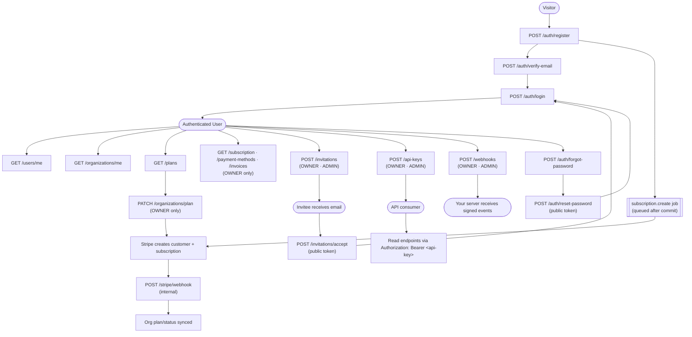

# NestJS SaaS Starter


A production-ready, multi-tenant SaaS backend built with NestJS. Authentication, RBAC, organizations, API keys, webhooks, usage tracking, audit logging, Stripe billing, and job queues out of the box.

## Contents

- [Features](#features)
- [Tech Stack](#tech-stack)
- [Getting Started](#getting-started)
- [Configuration](#configuration)
- [Commands](#commands)
- [API](#api)
- [Authentication & Access Control](#authentication--access-control)
- [Security](#security)
- [Plans & Billing](#plans--billing)
- [Webhooks](#webhooks)
- [Background Jobs](#background-jobs)
- [Database](#database)
- [Testing & CI](#testing--ci)
- [Project Structure](#project-structure)
- [Deploying to AWS](#deploying-to-aws)
- [Roadmap & Known Issues](#roadmap--known-issues)

---

## Features

- **Auth** — register, email verification, login, refresh-token rotation, logout, forgot/reset/change password, email change with confirmation
- **Multi-tenancy** — organizations with slugs; roles `OWNER > ADMIN > MEMBER`; invitations with expiry
- **API keys** — org-scoped, hashed, optional expiry, last-used tracking, plan-limited
- **Webhooks** — HMAC-SHA256 signed delivery, retries, per-event delivery history
- **Billing** — Stripe subscriptions, trials with grace period, plan switching, invoices and payment methods
- **Plan limits** — API calls per month, members, API keys, webhooks (`-1` means unlimited)
- **Usage tracking** — Redis counters synced to Postgres, monthly reset
- **Audit logging** — org-scoped `GET /audit-logs` with date filtering
- **Onboarding assistant** — `POST /onboarding/ask`, answered by Groq or Claude using the org's plan and usage
- **Operations** — rate limiting, Helmet, health check, Swagger docs (non-production), Docker Compose

---

## Tech Stack

- **Framework**: NestJS 11 (Node.js 22 / TypeScript)
- **Database**: PostgreSQL via TypeORM
- **Cache / Queue**: Redis (ioredis) + BullMQ
- **Auth**: JWT (access token in body, refresh token in HTTP-only cookie) + API key (passport-custom)
- **Email**: AWS SES (production) / Mailtrap (dev/QA)
- **Scheduling**: @nestjs/schedule
- **Rate limiting**: @nestjs/throttler
- **Password hashing**: Argon2
- **Payments**: Stripe
- **AI**: Groq (`openai/gpt-oss-20b` by default, set via `GROQ_MODEL`) or Anthropic Claude (`claude-haiku-4-5`) behind a pluggable provider
- **Observability**: [`@nestjs/observe`](https://observe.nestjs.com) (traces and metrics)
- **API docs**: Swagger / OpenAPI (`@nestjs/swagger`)
- **Containers**: Docker + Docker Compose

---

## Getting Started

### Prerequisites

- Node.js 22+ (see `.nvmrc`)
- Yarn
- Docker & Docker Compose

### With Docker (recommended)

```bash
docker-compose up
```

Starts the NestJS app, PostgreSQL, and Redis together.

### Without Docker

1. Start PostgreSQL and Redis locally.
2. Create your environment file and fill it in (see [Configuration](#configuration)):

```bash
cp .env.example .env
```

3. Install dependencies, run migrations, and seed the plans:

```bash
yarn install
yarn migration:run
yarn seed:run
yarn start:dev
```

### Stripe prices

`yarn seed:run` inserts the Free, Pro, and Enterprise plans. **Every plan needs a `stripePriceId`**, because each registration creates a Stripe subscription. Set your own Stripe test price IDs in `src/database/seeds/plan.seeder.ts` before seeding, or update the rows afterwards:

```sql
UPDATE plans SET stripe_price_id = 'price_xxx' WHERE name = 'Free';
UPDATE plans SET stripe_price_id = 'price_yyy' WHERE name = 'Pro';
UPDATE plans SET stripe_price_id = 'price_zzz' WHERE name = 'Enterprise';
```

Create products and prices in the [Stripe Dashboard](https://dashboard.stripe.com/products) or with the Stripe CLI. Use test mode and card `4242 4242 4242 4242`.

### Stripe webhooks (local)

```bash
brew install stripe/stripe-cli/stripe
stripe login
stripe listen --forward-to localhost:3000/stripe/webhook
```

Put the printed `whsec_...` value in `.env` as `STRIPE_WEBHOOK_SECRET`, restart the app, then trigger events:

```bash
stripe trigger customer.subscription.updated
stripe trigger invoice.payment_failed
stripe trigger customer.subscription.deleted
```

In production, register `https://yourdomain.com/stripe/webhook` in the Stripe Dashboard (Developers → Webhooks) with those three events.

---

## Configuration

Copy `.env.example` to `.env`. The app **fails at startup** when a required variable is missing: `ORIGIN` in production, plus the Stripe, JWT, throttler, API-key, and email settings.

| Variable                 | Description                                                                    | Example                 |
| ------------------------ | ------------------------------------------------------------------------------ | ----------------------- |
| `NODE_ENV`               | `production` enables SES email and disables Swagger                            | `development`           |
| `PORT`                   | HTTP port (optional, defaults to 3000)                                         | `3000`                  |
| `ORIGIN`                 | CORS allowed origins, comma-separated. **Required** when `NODE_ENV=production` | `http://localhost:3000` |
| `URL_PATH`               | Base URL for links in emails (use the frontend URL in prod)                    | `http://localhost:5173` |
| `DB_HOST`                | Postgres host                                                                  | `localhost`             |
| `DB_PORT`                | Postgres port                                                                  | `5432`                  |
| `DB_USER`                | Postgres user                                                                  | `saas_user`             |
| `DB_PASSWORD`            | Postgres password                                                              | `saas_password`         |
| `DB_NAME`                | Postgres database                                                              | `saas_dev`              |
| `DB_SYNC`                | Auto-sync entities. Must be `false` for migrations and in production           | `false`                 |
| `DB_LOGGING`             | Enable query logging                                                           | `false`                 |
| `DB_SSL`                 | Use SSL for the Postgres connection (for example RDS)                          | `false`                 |
| `DB_MIGRATIONS_RUN`      | Run pending migrations at startup. Set `true` on deployed services              | `false`                 |
| `REDIS_HOST`             | Redis host                                                                     | `localhost`             |
| `REDIS_PORT`             | Redis port                                                                     | `6379`                  |
| `JWT_SECRET`             | Access token secret                                                            | `your_secret`           |
| `JWT_EXPIRES_IN`         | Access token TTL                                                               | `15m`                   |
| `JWT_REFRESH_SECRET`     | Refresh token secret                                                           | `your_refresh_secret`   |
| `JWT_REFRESH_EXPIRY`     | Refresh token TTL                                                              | `7d`                    |
| `REFRESH_TOKEN_TTL`      | Refresh token Redis TTL (seconds)                                              | `604800`                |
| `COOKIE_SECURE`          | Set `Secure` on the refresh-token cookie                                       | `true`                  |
| `COOKIE_SAME_SITE`       | `SameSite` for the refresh-token cookie                                        | `none`                  |
| `TTL_EXPIRATION`         | Email-verify / password-reset / email-change token TTL (seconds)               | `86400`                 |
| `INVITE_TOKEN_TTL`       | Invitation token TTL (seconds)                                                 | `172800`                |
| `API_KEY_PREFIX`         | Required prefix of API keys                                                    | `sk_live_`              |
| `API_KEY_EXPIRATION`     | API key lookup cache TTL (seconds). Keep it short: edits wait for it           | `300`                   |
| `THROTTLER_TTL`          | Rate-limit window (ms)                                                         | `60000`                 |
| `THROTTLER_LIMIT`        | Max requests per window                                                        | `600`                   |
| `THROTTLER_AUTH_LIMIT`   | Max requests per window on auth routes                                         | `100`                   |
| `STRIPE_SECRET_KEY`      | Stripe secret key                                                              | `sk_test_...`           |
| `STRIPE_WEBHOOK_SECRET`  | Stripe webhook signing secret                                                  | `whsec_...`             |
| `MAILTRAP_API_KEY`       | Mailtrap API key (non-production only)                                         | `your_key`              |
| `MAILTRAP_TEST_INBOX_ID` | Mailtrap inbox ID (non-production only)                                        | `123456`                |
| `MAILTRAP_FROM_EMAIL`    | Mailtrap sender address (non-production only)                                  | `noreply@example.com`   |
| `MAILTRAP_FROM_NAME`     | Mailtrap sender name (non-production only)                                     | `SaaS App`              |
| `AWS_ACCESS_KEY_ID`      | AWS access key (production only)                                               | `AKIA...`               |
| `AWS_SECRET_ACCESS_KEY`  | AWS secret key (production only)                                               | `your_secret`           |
| `AWS_REGION`             | AWS region for SES (production only)                                           | `us-east-1`             |
| `SES_FROM_EMAIL`         | Verified SES sender address (production only)                                  | `noreply@example.com`   |
| `AI_PROVIDER`            | AI backend: `groq` or `claude`                                                 | `groq`                  |
| `GROQ_API_KEY`           | Required when `AI_PROVIDER=groq`                                               | `gsk_...`               |
| `GROQ_MODEL`             | Groq model id (optional)                                                       | `openai/gpt-oss-20b`    |
| `ANTHROPIC_API_KEY`      | Required when `AI_PROVIDER=claude`                                             | `sk-ant-...`            |
| `OBSERVE_APP_KEY`        | `@nestjs/observe` app key; set it in deployed environments                     | unset                   |
| `OBSERVE_APP_SECRET`     | `@nestjs/observe` app secret; set it in deployed environments                  | unset                   |

---

## Commands

```bash
# Development
yarn start:dev          # Watch mode
yarn build              # Compile to dist/
yarn start:prod         # Run compiled output

# Testing (details in Testing & CI)
yarn test               # Unit tests
yarn test:watch         # Watch mode
yarn test:cov           # Coverage report
yarn test:e2e           # E2E tests (starts and stops its own Docker services)
yarn test auth.service                        # One unit test file

# Code quality
yarn lint               # ESLint with --fix
yarn format             # Prettier
npx madge --circular --extensions ts --exclude '\.entity\.ts$' src/main.ts   # Circular imports

# Database (details in Database)
yarn migration:generate src/database/migrations/<Name>
yarn migration:run
yarn migration:revert
yarn migration:show
yarn seed:run           # Populate the plans table
```

---

## API

Interactive docs are served while the app runs, and are always current:

- **Swagger UI**: `http://localhost:3000/api/docs`
- **OpenAPI JSON**: `http://localhost:3000/api/docs-json`

Schemas come from each DTO's `class-validator` decorators through the `@nestjs/swagger` CLI plugin, and descriptions come from JSDoc comments on DTOs and controllers. Click **Authorize** to try authenticated endpoints with a bearer JWT or API key. Swagger is on whenever `NODE_ENV` is not `production`, and always off in production.

Request bodies are validated globally: unknown fields are rejected with `400` and values are cast to the DTO types.

### User journey



### Endpoints

"JWT only" means API keys are rejected. Everything not marked Public needs a JWT or an API key.

#### Auth — `/auth`

| Method | Endpoint                    | Access   | Description                                                                                                                                   |
| ------ | --------------------------- | -------- | --------------------------------------------------------------------------------------------------------------------------------------------- |
| POST   | `/auth/register`            | Public   | Register new org + owner user. Returns only `{ message }`; an already-registered email gets the same response (and an "account exists" email) |
| POST   | `/auth/login`               | Public   | Returns `accessToken` in the body and sets the `refreshToken` HTTP-only cookie                                                                |
| POST   | `/auth/verify-email`        | Public   | Verify email with token                                                                                                                       |
| POST   | `/auth/resend-verification` | Public   | Resend verification email                                                                                                                     |
| POST   | `/auth/refresh-token`       | Public   | Rotate tokens: reads the cookie, returns a new `accessToken`, sets a new cookie                                                               |
| POST   | `/auth/forgot-password`     | Public   | Send password reset email                                                                                                                     |
| POST   | `/auth/reset-password`      | Public   | Reset password; returns `accessToken` and sets a new cookie                                                                                   |
| POST   | `/auth/change-password`     | JWT only | Change password; returns `accessToken` and sets a new cookie                                                                                  |
| POST   | `/auth/logout`              | JWT only | Blacklist the access token and clear the refresh cookie                                                                                       |

#### Users — `/users`

| Method | Endpoint                  | Access   | Description                               |
| ------ | ------------------------- | -------- | ----------------------------------------- |
| GET    | `/users/me`               | JWT only | Current user profile                      |
| PATCH  | `/users/me`               | JWT only | Update profile (firstName, lastName)      |
| POST   | `/users/me/email`         | JWT only | Request email change (sends verification) |
| POST   | `/users/me/email/confirm` | Public   | Confirm email change with token           |

#### Organizations — `/organizations`

| Method | Endpoint                              | Access                | Description                                                       |
| ------ | ------------------------------------- | --------------------- | ----------------------------------------------------------------- |
| GET    | `/organizations/me`                   | Authenticated         | Org details                                                       |
| GET    | `/organizations/members`              | Authenticated         | List members                                                      |
| PUT    | `/organizations/me`                   | JWT only, Owner/Admin | Update org name                                                   |
| PATCH  | `/organizations/plan`                 | JWT only, Owner       | Switch plan; ends any active trial and starts billing immediately |
| PUT    | `/organizations/members/:userId/role` | JWT only, Owner       | Update member role                                                |
| DELETE | `/organizations/members/:userId`      | JWT only, Owner/Admin | Remove member                                                     |

#### Plans — `/plans`

| Method | Endpoint | Access | Description          |
| ------ | -------- | ------ | -------------------- |
| GET    | `/plans` | Public | List available plans |

#### Invitations — `/invitations`

| Method | Endpoint              | Access                | Description                                            |
| ------ | --------------------- | --------------------- | ------------------------------------------------------ |
| GET    | `/invitations`        | Authenticated         | List invitations (query: `status`, default: `pending`) |
| POST   | `/invitations`        | JWT only, Owner/Admin | Send invitations                                       |
| POST   | `/invitations/accept` | Public                | Accept an invitation with its token                    |

#### API keys — `/api-keys`

| Method | Endpoint        | Access                | Description    |
| ------ | --------------- | --------------------- | -------------- |
| GET    | `/api-keys`     | Owner/Admin           | List API keys  |
| POST   | `/api-keys`     | JWT only, Owner/Admin | Create API key (optional `expiresAt`, a future date) |
| DELETE | `/api-keys/:id` | JWT only, Owner/Admin | Revoke API key |

#### Webhooks — `/webhooks`

| Method | Endpoint                   | Access                | Description                      |
| ------ | -------------------------- | --------------------- | -------------------------------- |
| GET    | `/webhooks`                | JWT only, Owner/Admin | List webhook endpoints           |
| POST   | `/webhooks`                | JWT only, Owner/Admin | Create webhook endpoint          |
| DELETE | `/webhooks/:id`            | JWT only, Owner/Admin | Delete webhook endpoint          |
| GET    | `/webhooks/:id/deliveries` | JWT only, Owner/Admin | Delivery history for an endpoint |

#### Usage, audit, onboarding, health

| Method | Endpoint          | Access        | Description                                                             |
| ------ | ----------------- | ------------- | ----------------------------------------------------------------------- |
| GET    | `/usage`          | Authenticated | Current API call usage, limit, and period                               |
| GET    | `/audit-logs`     | Authenticated | Org audit log, newest first; optional `from`/`to`; excludes auth events |
| POST   | `/onboarding/ask` | Authenticated | Ask the AI assistant a question (max 2000 characters)                   |
| GET    | `/health`         | Public        | `{ status: 'ok', db: 'up' }`; 503 if Postgres is down                   |

#### Billing — `/subscription`, `/payment-methods`, `/invoices`

| Method | Endpoint           | Access          | Description                                                                                         |
| ------ | ------------------ | --------------- | --------------------------------------------------------------------------------------------------- |
| GET    | `/subscription`    | JWT only, Owner | Subscription status plus `paymentMethods[]` (shaped cards; `isDefault` flags the subscription card) |
| GET    | `/payment-methods` | JWT only, Owner | The org's Stripe payment methods (raw Stripe shape)                                                 |
| GET    | `/invoices`        | JWT only, Owner | The org's Stripe invoices                                                                           |

#### Stripe — `/stripe`

| Method | Endpoint          | Access | Description                                |
| ------ | ----------------- | ------ | ------------------------------------------ |
| POST   | `/stripe/webhook` | Public | Receive Stripe events (signature verified) |

---

## Authentication & Access Control

Two parallel strategies, both sent as `Authorization: Bearer <token>`:

- **JWT** — standard access token.
- **API key** — org-scoped. The key must start with `API_KEY_PREFIX`; it is SHA-256 hashed, looked up in Redis (`apikey:valid:<hash>`, filled on first use and cleared when the key is revoked), then in the database. `expiresAt` is checked on both paths, and `last_used_at` is written at most once a minute. API keys are **read-only by design**: every `POST`, `PATCH`, and `DELETE` endpoint is `@JwtOnly()`. Scopes are stored but not enforced yet.

Three global guards run in order: `JwtGuard` → `RolesGuard` → `JwtOnlyGuard`.

### Token flow

1. Register → verification email sent.
2. Verify email → account activated.
3. Login → `accessToken` (15m) in the JSON body; `refreshToken` (7d) as an HTTP-only cookie.
4. Refresh → `POST /auth/refresh-token` reads the cookie, rotates both tokens, and sets a new cookie. The old token is dropped.
5. Logout → refresh token deleted, cookie cleared, access token blacklisted until it would have expired.

> **Frontend requirement**: the API sends CORS `credentials: true`, so the frontend must send requests with `credentials: 'include'` (fetch) or `withCredentials: true` (axios). Set `ORIGIN` to the frontend's exact origin; `'*'` does not work with credentialed requests.

### Roles

`OWNER > ADMIN > MEMBER`

- Only an OWNER can change roles. Nobody can assign OWNER or change another OWNER.
- OWNER and ADMIN can remove members. Nobody can remove themselves, and an ADMIN cannot remove an ADMIN or OWNER.
- API key create and delete need a JWT.

### Decorators

| Decorator              | Effect                                      |
| ---------------------- | ------------------------------------------- |
| `@Public()`            | Bypass authentication                       |
| `@JwtOnly()`           | Reject API keys, require a JWT              |
| `@Roles(UserRole.X)`   | Enforce role-based access                   |
| `@CurrentUser()`       | Inject the current user                     |
| `@AuditContext()`      | Inject audit context (userId, orgId, email) |
| `@SkipUsageTracking()` | Skip the usage tracker for a route          |

### Interceptors

| Interceptor                      | Effect                                                                       |
| -------------------------------- | ---------------------------------------------------------------------------- |
| `UsageTrackerInterceptor`        | Global. Counts API calls per org and enforces the plan limit                 |
| `WebhookTrackerInterceptor`      | Dispatches webhook events after successful mutations; enforces `maxWebhooks` |
| `MemberInviteTrackerInterceptor` | Fires `member.invited` and enforces `maxMembers`                             |

### Redis keys

| Key                     | Purpose                                     |
| ----------------------- | ------------------------------------------- |
| `auth:refresh:<userId>` | SHA-256 of the user's current refresh token |
| `auth:blacklist:<hash>` | Blacklisted access tokens                   |
| `verify:email:<hash>`   | Email verification tokens                   |
| `reset:password:<hash>` | Password reset tokens                       |
| `invite:<hash>`         | Invitation tokens                           |
| `change:email:<hash>`   | Email change confirmation tokens            |
| `apikey:valid:<hash>`   | API key lookup cache                        |
| `apikey:used:<id>`      | Limits `last_used_at` writes to one a minute |
| `usage:*:api_calls:*`   | Usage counters                              |

`<hash>` is `hashToken(token)`, a SHA-256 hex digest (`src/common/utils/hash-token.util.ts`). The raw token only exists in the email link, the refresh cookie, or the `Authorization` header, and is re-hashed on lookup.

---

## Security

- **Tokens in Redis are hashed.** A Redis leak or backup does not expose usable credentials. Email jobs in the BullMQ queue still carry the raw token while queued; failed email jobs are kept for 24 hours at most.
- **No account enumeration** on unauthenticated paths. Register answers the same for new and existing emails and emails the real owner instead. Login runs a dummy Argon2 verification for unknown emails so timing matches. Forgot-password, resend-verification, and change-email give generic answers. Known exceptions: `POST /invitations` says a blocked email "may already be registered with another organization", and small timing differences remain where a Redis write only happens for real accounts.
- **Failed logins are audited** as `auth.login_failed` with a reason (`unknown_user`, `invalid_password`, `email_not_verified`, `account_deactivated`), IP, and user agent. The submitted email is never stored. These rows are hidden from `GET /audit-logs`.
- **HTTP headers.** API responses get a strict Content-Security-Policy (`default-src 'none'`, no framing). Swagger UI gets Helmet's default policy so its assets load.
- **CORS** uses an explicit allow-list from `ORIGIN`. Startup fails in production if it is unset.
- **Logs never contain secrets.** Errors are logged as name, message, and stack only, and webhook job data is never logged.
- **Passwords** use Argon2. Auth routes have a stricter rate limit.
- **Swagger is off in production.**

---

## Plans & Billing

| Plan       | Price | Trial   | API calls / month | Members   | API keys  | Webhooks  |
| ---------- | ----- | ------- | ----------------- | --------- | --------- | --------- |
| Free       | $0    | none    | 100               | 5         | 2         | 0         |
| Pro        | $19   | 14 days | 50,000            | 25        | 10        | 100       |
| Enterprise | $99   | 30 days | unlimited         | unlimited | unlimited | unlimited |

The numbers come from the seeder; change them there. A limit of `-1` means unlimited.

- **Registration** creates the org, then queues `subscription.create`. A worker creates the Stripe customer and subscription (deferring the charge while the plan's trial runs). No payment method is attached at this stage.
- **Org payment status** is one of `FREE`, `TRIAL`, `ACTIVE`, `SUSPENDED`, `CANCELLED`, and is kept in sync by Stripe webhooks (`customer.subscription.updated`, `customer.subscription.deleted`, `invoice.payment_failed`).
- **Trial expiry** runs daily at midnight: an org whose trial ended with no Stripe subscription is suspended, then cancelled and deactivated after a 5-day grace period.
- **Switching plans** (`PATCH /organizations/plan`) ends any active trial immediately and switches the Stripe price with proration.

---

## Webhooks

Delivered as an HMAC-SHA256 signed HTTP POST with these headers: `X-Webhook-Signature`, `X-Webhook-Timestamp`, `X-Webhook-Delivery`, `X-Webhook-Event`.

| Event                    | Trigger                |
| ------------------------ | ---------------------- |
| `member.invited`         | Invitation sent        |
| `member.invite_accepted` | Invitation accepted    |
| `member.role_updated`    | Member role changed    |
| `member.updated`         | Member profile updated |
| `member.removed`         | Member removed         |
| `member.email_updated`   | Member email changed   |
| `org.updated`            | Organization updated   |
| `apikey.created`         | API key created        |
| `apikey.revoked`         | API key revoked        |
| `plan.limit_exceeded`    | Usage limit hit        |

`plan.upgraded`, `plan.downgraded`, and `api.limit_exceeded` exist in the enum but are not dispatched yet.

Delivery: 5-second timeout, 3 attempts with exponential backoff (a `404` is not retried). Each event has one delivery record, created `PENDING` and updated in place on every retry until it ends `SUCCESS` or `FAILED`.

---

## Background Jobs

| Queue               | Handles                                                                                                   |
| ------------------- | --------------------------------------------------------------------------------------------------------- |
| `emailQueue`        | Welcome, verification, invite, password reset, email change, and the "you already have an account" notice |
| `webhookQueue`      | Signed webhook delivery (see [Webhooks](#webhooks))                                                       |
| `subscriptionQueue` | `subscription.create`, queued after the registration transaction commits                                  |

| Cron                   | Job                                                                                  |
| ---------------------- | ------------------------------------------------------------------------------------ |
| Every 5 minutes        | Sync usage counters from Redis to Postgres                                           |
| 1st of month, midnight | Reset monthly usage counters in Redis                                                |
| Daily, midnight        | Expire pending invitations past `expiresAt`                                          |
| Daily, midnight        | Suspend orgs whose trial expired; cancel and deactivate after the 5-day grace period |

---

## Database

PostgreSQL via TypeORM. Users and API keys are soft-deleted (`isActive: false`). Migrations live in `src/database/migrations/` and are the source of truth for the schema.

- Set `DB_SYNC=false` before running migrations, and never use `DB_SYNC=true` in production. E2E tests use it on purpose against a throwaway database.
- **Deployed services**: set `DB_MIGRATIONS_RUN=true` so pending migrations run when the app starts, before it accepts traffic. A failing migration stops startup. This suits a single instance; with several instances starting together, run `yarn migration:run` as a separate release step instead and leave the flag off. Locally it stays off and you run `yarn migration:run` yourself.
- `data-source.ts` (used only by the CLI) loads entities from both `src/` and `dist/`. **Run `yarn build` before `migration:generate`**, otherwise a stale `dist/` produces bogus drop and recreate statements.
- A nullable column typed `X | null` needs an explicit `type` in `@Column(...)`, because TypeORM cannot infer a type from a union.

---

## Testing & CI

```bash
yarn test       # unit tests (jest, src/**/*.spec.ts)
yarn test:e2e   # e2e tests (test/*.e2e-spec.ts)
```

`yarn test:e2e` starts the services in `docker-compose.test.yml` (Postgres on `5433`, database `saas_test`; Redis on `6380`), runs the suites in order, then removes the containers and volumes. Your dev database is never touched.

To run a single e2e file, start the services yourself (arguments after `yarn test:e2e` are not forwarded to jest):

```bash
docker compose -f docker-compose.test.yml up -d --wait
npx jest --config ./test/jest-e2e.json --runInBand test/auth.e2e-spec.ts
docker compose -f docker-compose.test.yml down --volumes
```

Test helpers in `test/helpers/`:

| File           | Purpose                                                                                          |
| -------------- | ------------------------------------------------------------------------------------------------ |
| `env.setup.ts` | Hardcodes environment variables before anything loads (test DB and Redis ports, fake secrets)    |
| `app.setup.ts` | Builds the Nest app with the email queue, AI provider, and Stripe replaced by stubs; seeds plans |
| `fixtures.ts`  | Shared data and helpers, such as reading a raw token from a queued email job                     |

Suites: `app`, `auth`, `users`, `organizations`, `plans`, `api-keys`, `invitations`, `webhooks`, `usage`, `subscription`, `audit-logs`, `onboarding`, `swagger`.

GitHub Actions (`.github/workflows/ci.yml`) runs on pushes and pull requests to `main`: install, lint, unit tests, e2e tests. Workflows from first-time outside contributors wait for your approval before they run.

---

## Project Structure

```
src/
  app.module.ts              # Root module
  main.ts                    # Bootstrap (Helmet, CORS, cookies, validation, Swagger)
  swagger.setup.ts           # OpenAPI setup (off in production)
  config/                    # database, jwt, cors, helmet configuration
  database/
    database.module.ts       # TypeORM setup
    data-source.ts           # CLI DataSource (migrations/seeds)
    migrations/              # TypeORM migrations
    seeds/                   # Plan seeder
  cache/                     # Redis wrapper
  jobs/
    queues/                  # Producers (email, webhook, subscription)
    processors/              # BullMQ workers
    schedulers/              # Cron jobs
    job-data.types.ts        # Typed queue payloads
  common/
    decorators/              # @Public, @JwtOnly, @Roles, @CurrentUser, @AuditContext, @SkipUsageTracking
    dto/                     # Shared DTOs
    interceptors/            # Usage tracker
    utils/                   # hashToken, logError, JWT and slug helpers
  enums/
  modules/
    auth/  users/  organizations/  plans/  invitations/  api-keys/
    webhook/  webhook-dispatchers/  webhook-deliveries/
    usage/  usage-records/  audit-logs/
    stripe/                  # Stripe client, webhook handler, Stripe-derived types
    billing/                 # /subscription, /payment-methods, /invoices
    health/  onboarding/
```

---

## Deploying to AWS

Target layout, all in one VPC:

```
Your VPC
├── ECS Fargate (NestJS app)   ← public via a load balancer
├── RDS (PostgreSQL)           ← private subnet, reachable from ECS only
└── ElastiCache (Valkey)       ← private subnet, reachable from ECS only
```

Suggested order: RDS → ElastiCache → ECR (push the image from the existing `Dockerfile`) → ECS. Email already sends through SES when `NODE_ENV=production`.

- **RDS**: same TypeORM config; set `DB_HOST`, credentials, and `DB_SSL=true`.
- **ElastiCache**: choose **Valkey** in **non-cluster mode**, because BullMQ's Lua scripts break in cluster mode. Same ioredis client; set `REDIS_HOST`.

**Using ElastiCache from your laptop** (it has no public endpoint): launch a small EC2 instance in the same VPC with SSH allowed from your IP, allow port 6379 from that instance's security group to ElastiCache, then open a tunnel and point the app at it:

```bash
ssh -i /path/to/key.pem -L 6379:<PRIMARY_ENDPOINT>:6379 -N ec2-user@<EC2_PUBLIC_IP>
# .env: REDIS_HOST=127.0.0.1  REDIS_PORT=6379
```

---

## Roadmap & Known Issues

This is the single list of open work. Done items are described in the sections above.

### Planned features

- [ ] Trial warning email, one day before a trial ends. Switch the trial-expiry scheduler to chunked updates at the same time (batches of about 500 with try/catch per batch, using the IDs for logging and emails), because `updateMany` only returns a count
- [ ] Stripe idempotency key on the plan-switch update, to prevent a double charge on a double click
- [ ] `pendingPlan` on the org for scheduled downgrades (today upgrades and downgrades both apply immediately)
- [ ] Dispatch `plan.upgraded`, `plan.downgraded`, and `api.limit_exceeded`
- [ ] Webhook test events and replay of failed deliveries
- [ ] Usage warnings at 80% and 95% of a limit; track `WEBHOOK_CALLS`, `DATA_STORAGE`, `ACTIVE_USERS` (defined in `UsageMetric`, never recorded)
- [ ] Enforce API key scopes per endpoint, and invalidate the cached key when scopes change
- [ ] Notice email to the real owner when someone tries to change their email to it (register already does this)
- [ ] Multi-organization membership. Today `users.email` is unique and a user has one organization; supporting more needs a membership table, org-scoped JWTs, and an org switcher
- [ ] Organization deletion and ownership transfer
- [ ] Pagination and filtering on list endpoints
- [ ] AI usage insights (`GET /usage/insights`) and audit-log anomaly detection (auto-blacklist IPs with many failed logins; add an `ip_address` index with it)
- [ ] AWS: RDS, ElastiCache, ECR + ECS, and S3 for file uploads

### Technical debt

**Security**

- [ ] Registration still has a check-then-insert slug lookup. A collision inside the transaction surfaces as a raw database error; the fix is to retry the whole transaction with a suffixed slug (org rename already does this)
- [ ] `invitations.token` is stored in plaintext in Postgres, and `acceptInvitation` falls back to it. Hash it (migration plus backfill)
- [ ] Create tokens inside the email worker so the raw token never sits in queue job data (needs a `TokenService`)
- [ ] Redis `AUTH`/TLS in `CacheService`, and ElastiCache at-rest encryption

**Performance and reliability**

- [ ] `GET /organizations/members` returns every member with no limit
- [ ] `BillingService.createSubscription()` makes four database writes with no transaction; a crash in between leaves an org with a Stripe customer but no subscription
- [ ] The invitation accept flow creates the user and updates the invitation in separate writes
- [ ] `getPlanLimit()` hits the database on every cache miss in the usage tracker
- [ ] `updateLastUsed()` and audit-log writes are fire-and-forget with no retry
- [ ] `GET /payment-methods` is largely redundant with `/subscription`'s `paymentMethods[]`

**Code quality**

- [ ] The audit-plus-webhook dispatch `.catch()` pattern is copied across about six services; extract a helper
- [ ] Token creation plus caching is repeated five times; extract a `TokenService`
- [ ] Cache key strings are hardcoded across services; add a `CacheKeys` class
- [ ] `@IsStrongPassword()` options are copied in three DTOs; add one `@StrongPassword()` decorator
- [ ] Queue options are duplicated between the email and webhook queues
- [ ] The limit-check logic is duplicated between two interceptors; extract a base class
- [ ] Add `OrganizationService.getActiveOrThrow()` for the repeated not-found/inactive check
- [ ] Magic numbers: `apiKey.slice(0, 12)` and the 5-day trial grace period
- [ ] No unit tests yet for the email processor, the usage sync and reset schedulers, and the three interceptors

---

## ⭐ Support

If this project helped you, please give it a **star on GitHub** —
it helps other developers find it and motivates me to keep improving it!

[](https://github.com/dahboorSa/NestJS-SaaS-Starter)

---

## 👩‍💻 Author

Made with 🌸 by **Saba Dahboor**

[](https://www.linkedin.com/in/saba-dahboor/)

---

## License

Noncommercial — see [LICENSE](LICENSE). Free to use, copy, modify, and share for education, learning, personal projects, and research. Commercial use requires prior written permission.
